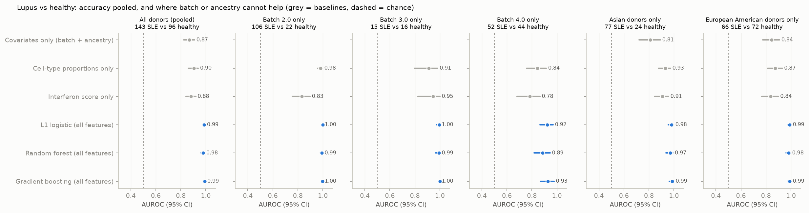
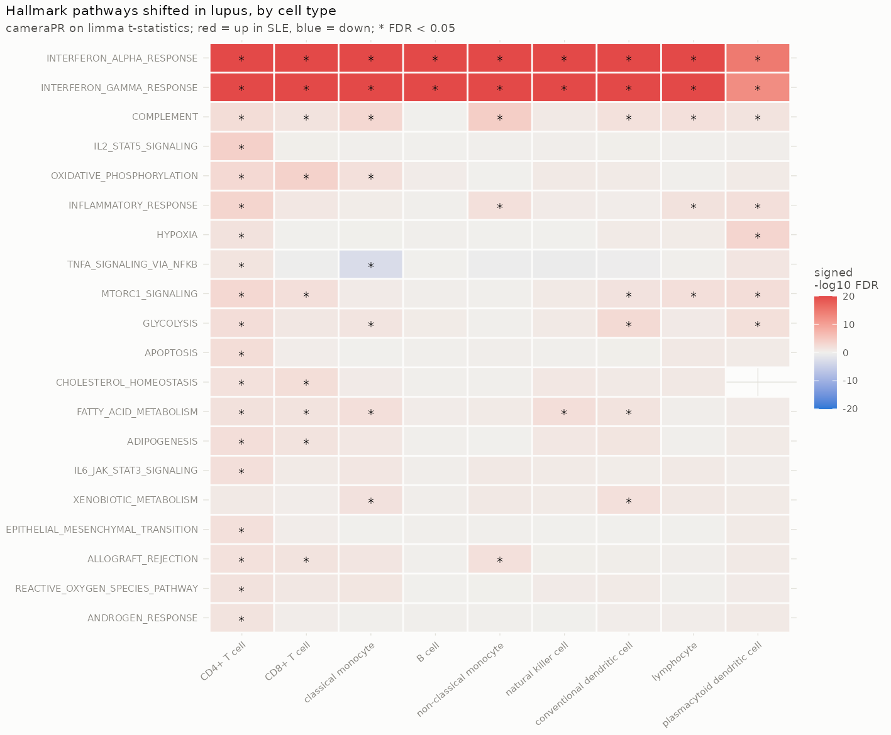
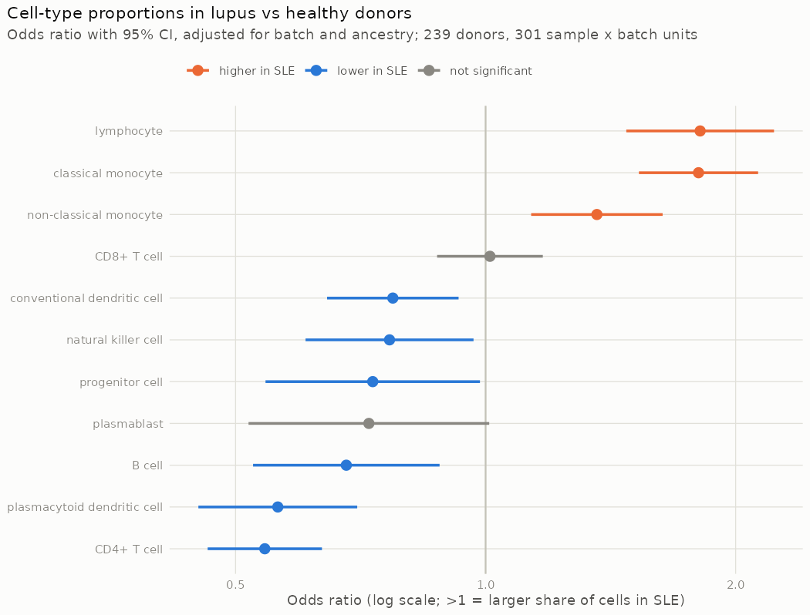
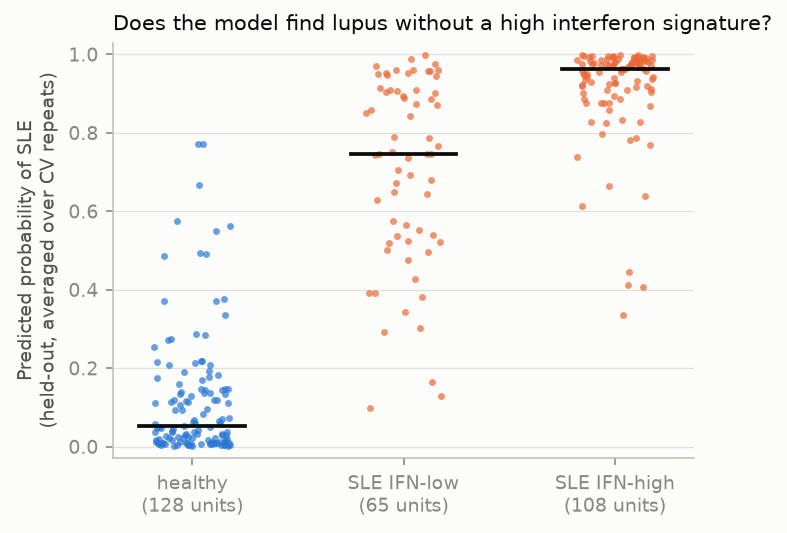

# Can a blood sample tell you who has lupus?

**Pseudobulk statistics and donor-level machine learning on 1.26 million single blood cells from 162 lupus patients and 99 healthy controls, built around one question: how much of the accuracy survives once batch, ancestry and 10x pool cannot explain it?**

## Results in brief

- **Pooled accuracy is inflated by batch.** A classifier on cell-type composition and pseudobulk expression reaches **AUROC 0.99**, but batch + ancestry alone already score **0.87**, and the same features identify the processing batch of *healthy* donors perfectly (AUROC 1.00).
- **The honest number is 0.92.** Within the one batch with balanced groups (52 lupus vs 44 healthy), where batch cannot help, the L1 logistic model scores **AUROC 0.92 (95% CI 0.86–0.97)**, against 0.49 for shuffled labels (permutation p = 0.0099, the minimum for 100 permutations).
- **Not a 10x-pool artefact.** Libraries are well mixed within batches (Cramér's V 0.09–0.19), and comparing only lupus and healthy samples run in the *same* 10x library gives AUROC **0.97** overall (95% CI 0.95–0.98) and 0.92 in batch 4, unchanged from the unrestricted score.
- **The interferon signature is in every immune cell type.** Interferon-α and interferon-γ response are the top Hallmark pathways in all nine cell types tested (FDR < 10⁻⁴). This is shown at the donor level, adjusted for batch and ancestry, and confirmed by limma-voom and DESeq2 (fold-change correlation 0.86–0.97).
- **The model is not just an interferon detector.** A third of the lupus patients (47 of 143) are interferon-low. Within the balanced batch, an interferon-only score cannot find them (AUROC 0.55), while the full model still does (**0.86**).
- **Composition shifts in lupus blood:** fewer CD4 T cells (odds ratio 0.54) and plasmacytoid DCs (0.56), more classical monocytes (1.80). Within "CD8 T cells", the strongest down-regulated genes are MAIT-cell markers (SLC4A10, ZBTB16, KLRB1, CCR6), pointing to MAIT-cell loss.



## The problem with this dataset

Perez et al. 2022 (*Science*) profiled 1,263,676 PBMCs with multiplexed 10x 3′ v2, in 23 pools over 4 processing batches. The phase-0 audit (`results/reports/01_data_audit.md`) found disease status tangled up with everything else:

| Variable | What the audit found | How the project handles it |
|---|---|---|
| Processing batch | Batch 1: 0 lupus / 28 healthy donors. Batch 2: 88 / 1. 54 samples sequenced in two batches | Batch in every model; evaluation **within** batches that hold both groups; cross-batch replicates kept as separate profiles; covariate-only baseline |
| Ancestry | Asian donors 83 lupus / 24 healthy; European 75 / 74 | Ancestry in every model; per-ancestry evaluation; 5 donors in very small groups left out |
| Sex | 15 of 17 men have lupus | Women only (239 donors: 143 lupus, 96 healthy) |
| 10x pool | Several donors per library | Within-library evaluation (below) |
| Repeated samples | Technical replicates; flare and post-treatment samples of the same patient | One sample per donor; all CV splits grouped by donor; `duplicateCorrelation` for replicates |

## Results

### 1. Interferon signalling is raised across the immune system



Pseudobulk limma-voom per cell type, `expression ~ disease + batch + ancestry`, with replicates handled by `duplicateCorrelation` on donor. Interferon-α and -γ response top every cell type. The six interferon-score genes (IFI27, IFI44L, IFIT1, ISG15, RSAD2, SIGLEC1) are 2–7 fold higher in lupus in T cells, B cells, NK cells and monocytes alike. DESeq2 on one profile per sample agrees closely: fold-change correlation 0.86–0.97, and 68–82% of limma's significant genes are also significant in DESeq2. Tables: `results/reports/08_differential_expression.md`.

### 2. Lupus blood has a different cell mix



Proportions use all 1.26M cells, modelled per sample on the logit scale with limma (the propeller approach). The CD4 T-cell and pDC losses and the monocyte expansion agree with the original paper. The B-cell result (odds ratio 0.68) appears only after batch adjustment, since raw percentages are near identical, so it is reported as model-dependent.

### 3. The classifier, and what is left once batch cannot help

| Model | Pooled | Batch 4 only (52 vs 44) | Batch 3 only (15 vs 16) | Batch 2 only (106 vs 22) |
|---|---|---|---|---|
| Batch + ancestry only | 0.87 | n/a | n/a | n/a |
| Interferon score only | 0.88 | 0.78 | 0.95 | 0.83 |
| Cell-type proportions only | 0.90 | 0.84 | 0.91 | 0.98 |
| **L1 logistic, all features** | **0.99** | **0.92** | 1.00 | 1.00 |
| Gradient boosting, all features | 0.99 | 0.93 | 1.00 | 1.00 |
| Random forest, all features | 0.98 | 0.89 | 0.99 | 0.99 |

- **Features:** cell-type composition (centred log-ratio) and pseudobulk log-CPM for seven cell types. The 1,000 most variable genes per cell type are chosen inside each training fold.
- **Validation:** 5-fold CV grouped by donor, repeated 5 times; the L1 penalty is tuned in an inner grouped CV.

Batch 4 is the reference result: it is the only batch with balanced groups. The near-perfect scores in batches 2 and 3 are not 10x-pool artefacts (section 5). A likely reason batch 4 is harder: its lupus patients have the weakest interferon signature of the three batches (median monocyte IFN score 0.03, against 0.12 in batch 2 and 0.46 in batch 3; phase 1), which fits milder or better-controlled disease.

### 4. Finding lupus without the interferon signature



A lupus donor counts as interferon-high when their monocyte interferon score is more than 2 SD above healthy donors of the same batch: 96 donors are IFN-high and 47 IFN-low. Within batch 4, the interferon-only score separates IFN-low patients from healthy donors no better than chance (0.55), while the full model reaches 0.86. Composition carries much of that (0.78 from proportions alone), together with expression changes outside the interferon pathway: lower MAIT-cell markers in CD8 T cells, and CD70 in CD4 T cells.

### 5. Pool check: same batch, same 10x library

<!-- POOL_CHECK_START -->

Comparing only lupus and healthy samples **run in the same 10x library** (so neither batch nor library can help), the classifier's AUROC is **0.97** (95% CI 0.95-0.98, 3,324 pairs). The signal holds: the model separates lupus from healthy samples run in the same 10x library.

| Setting | Libraries (with both groups) | Samples with a same-library partner | Cramér's V, library × diagnosis | Within-library AUROC, model | Within-library, IFN only | Ordinary AUROC, model |
|---|---|---|---|---|---|---|
| Batch 1.0 | 12 (0) | 0% |  |  |  |  |
| Batch 2.0 | 40 (36) | 93% | 0.18 | 1.00 | 0.87 | 1.00 |
| Batch 3.0 | 12 (12) | 100% | 0.13 | 1.00 | 0.98 | 0.98 |
| Batch 4.0 | 24 (24) | 100% | 0.09 | 0.92 | 0.83 | 0.92 |
| All batches | 88 (72) | 82% | 0.53 | 0.97 | 0.86 | 0.98 |

_Filled in by `make poolcheck`; details in `results/reports/10_pool_check.md`._

<!-- POOL_CHECK_END -->

### 6. Integration and annotation (phase 1)

- **Integration benchmark:** on the scib-metrics benchmark Harmony scored highest (0.72 vs 0.65 for scVI and 0.61 uncorrected), mainly through batch mixing.
- **Disease structure:** a disease-signal check within batch 4 showed neither method erased disease structure (classical monocytes: 1.25 / 1.25 / 1.29 enrichment of same-diagnosis neighbours from other donors).
- **How the embeddings are used:** for visualisation and annotation only. All statistics and models use uncorrected pseudobulk counts with batch as a covariate, because with this much confounding, batch correction can remove disease signal.
- **Annotation:** CellTypist agreed with the author labels for 92% of cells. The disagreements are informative: the authors' "lymphocyte" label is mostly cycling and regulatory T cells, and a third of conventional DCs sit with monocytes, the known DC2/monocyte overlap.

## What this does not show

- **Treatment.** Most lupus donors have "managed" disease and are on medication, which the dataset does not record. Some signals may be drug effects; for example, glucocorticoids suppress NF-κB signalling and shift monocyte and lymphocyte counts.
- **External validation.** Everything is cross-validated inside one cohort. A second lupus cohort is the real test.
- **Ancestry columns still contain batch,** so they are a weaker check than within-batch evaluation.
- **Diagnosis, not prognosis.** The model separates established lupus from health. It says nothing about early or undiagnosed disease.

## How it was built

| Phase | Scripts | What it does |
|---|---|---|
| 0. Data | `00_download.py`, `01_inspect.py`, `02_subsample.py` | Resumable 12 GB download; confounding audit; one streaming pass (memory set by block size, not file size) writing a 300-cell-per-sample subsample and pseudobulk over **all** cells, with cross-batch replicates kept apart |
| 1. Single cell | `03_qc.py`, `04_integrate.py`, `05_annotate.py` | Per-batch MAD-based QC; Harmony vs scVI (GPU) with scib-metrics plus a disease-signal check; interferon score; CellTypist with majority voting |
| 2. Statistics (R) | `06_export_pseudobulk.py`, `R/07_proportions.R`, `R/08_differential_expression.R` | Cohort rules applied once; propeller-style proportions; limma-voom + `duplicateCorrelation`, DESeq2 check, cameraPR on MSigDB Hallmark |
| 3. Classifier | `09_classifier.py` | Nested, donor-grouped CV; three baselines; within-batch and per-ancestry AUROC with bootstrap CIs; batch detectability; 100-run permutation null; IFN-low analysis; held-out block importance |
| 4. Checks | `10_pool_check.py` | Within-10x-library AUROC; how mixed each batch's libraries are |

Every phase has end-to-end tests on a mock dataset with the real file's layout. The mock plants known effects (an interferon signal in lupus monocytes, a composition shift, a batch effect), and the tests check that each is recovered and that nothing is found where nothing was planted.

## Reproduce

```bash
mamba create -n sle-py python=3.11 -y && conda activate sle-py
pip install -e ".[phase1]" pytest            # PyTorch with CUDA comes with scvi-tools
sudo apt install -y r-base-core r-bioc-limma r-bioc-edger r-bioc-deseq2 r-cran-ggplot2 r-cran-yaml r-cran-matrix

make test         # 26 tests on mock data, ~3 min
make download     # 12.2 GB from CELLxGENE, resumable
make inspect      # confounding audit: read this first
make genesets     # MSigDB Hallmark gene sets
make all          # subsample -> phase 1 -> phase 2 -> classifier -> pool check
```

Hardware used: a laptop with 7.4 GB RAM available to WSL and an RTX 4050 (6 GB). Peak RAM is about 5 GB. Approximate times: subsample 1.5 min, phase 1 about 25 min (scVI 10 min on the GPU), phase 2 about 1 hour (mostly DESeq2), classifier 15 min, pool check a few minutes.

## Repository layout

```
config/       config.yaml (paths, columns, subsampling), phase1/2/3.yaml (analysis parameters), mock.yaml
scripts/      00-10, one script per step (Python)
R/            phase-2 statistics
src/sle_pbmc/ streaming h5ad reader, sampling and pseudobulk, phase-1 and phase-3 helpers, figure style
tests/        mock data builder and end-to-end tests for every phase
results/      reports/ (markdown + csv for every step) and figures/
envs/         conda environments
```

## Data and citation

Perez RK, Gordon MG, Subramaniam M, et al. Single-cell RNA-seq reveals cell type–specific molecular and genetic associations to lupus. *Science* 376, eabf1970 (2022). Data from [CELLxGENE](https://cellxgene.cziscience.com/collections/436154da-bcf1-4130-9c8b-120ff9a888f2) (also GEO GSE174188). Genotypes are controlled-access and were not used.
